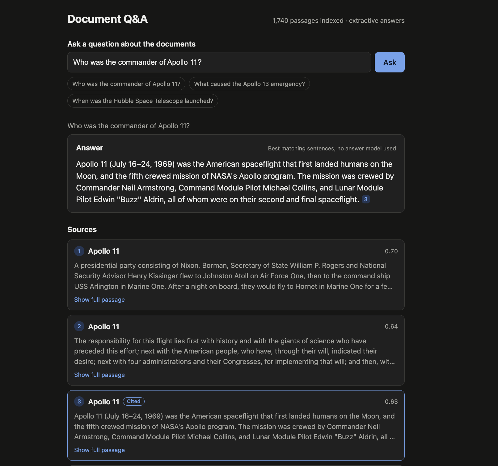
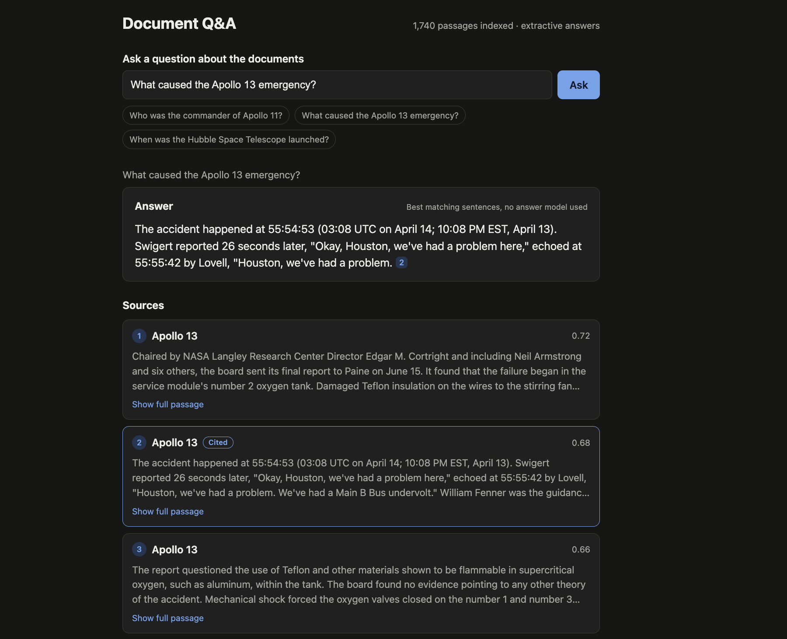

# Full-stack RAG Assistant

Ask questions about a set of documents and get an answer with numbered citations that link back to the exact passages.
React and TypeScript frontend, Spring Boot API, embedding retrieval through the ONNX MiniLM service, answers written by
Llama 3.3 70B on Groq. Without an API key it falls back to returning the best matching sentences.

## Screenshots

The running app answering an Apollo 11 question, with a numbered citation and the retrieved source passages.
These screenshots show the extractive fallback mode.



<details>
<summary>View the Apollo 13 answer and source passages</summary>



</details>

## Architecture

```
 React + TypeScript  --/api-->  Spring Boot  --/embed-->  ONNX embedding service (FastAPI, MiniLM)
   (Vite, port 5173)            (port 8080)                (port 8001)
                                   |
                                   +--> in-memory cosine index, saved to data/index.bin
                                   +--> Groq chat completions (optional)
```

The default corpus is 13 Wikipedia articles on the Apollo era and early spaceflight (`scripts/topics.txt`). Change the topic
list to use any other set of articles. Wikipedia text is CC BY-SA 4.0.

## Run it

You need Java 17+, Maven, Node 20+, and Python 3.11 (tested with the pinned embedding dependencies).
You can use the local embedding service below, or the separate ONNX project on port 8000.
Start each terminal at the project root.

```bash
# 1. Local embedding service (downloads the pinned real MiniLM ONNX model on first run)
python3 -m venv .venv
.venv/bin/pip install -r scripts/embedding-requirements.txt
.venv/bin/python scripts/serve_embeddings.py --port 8001

# 2. Download the corpus and check the test questions against it
python scripts/fetch_wikipedia.py
python eval/verify_questions.py

# 3. Backend (optional but recommended: a free key from console.groq.com)
cd backend
# Use this when running the local service above.
export EMBEDDING_URL=http://127.0.0.1:8001
# Optional: export GROQ_API_KEY with your real key before starting Maven.
mvn test
mvn spring-boot:run

# 4. Build the index (about a minute), from another terminal
curl -X POST localhost:8080/api/ingest

# 5. Frontend
cd frontend && npm ci && npm run dev      # http://localhost:5173
```

Run each server in its own terminal. Leave `GROQ_API_KEY` unset to use the extractive fallback.
The local service uses CPU inference with four threads, masked mean pooling, L2
normalization, and a 128-token limit. Its model revision is pinned in `scripts/serve_embeddings.py`; downloaded
model files are ignored by Git. If you already have the separate ONNX project, run
`MODEL_PATH=results/minilm.onnx THREADS=4 uvicorn service.app:app --port 8000` there and set
`EMBEDDING_URL=http://127.0.0.1:8000` for the backend instead.

## API

| Endpoint | Purpose |
|---|---|
| `POST /api/ask` `{"question": "...", "topK": 5}` | Answer with `answer`, `mode` (`llm`, `extractive`, `none`), `sources[]` and `note` |
| `POST /api/ingest` | Read `data/corpus/*.txt`, chunk, embed, save the index |
| `GET /api/health` | Indexed chunk count and answer mode |
| `GET /api/sources` | Chunks per document |

Each source has `n`, `docTitle`, `url`, `text`, cosine `score` and `cited`. The answer text contains markers such as `[1]` that
refer to `n`. The frontend turns them into buttons that jump to the passage.

## How it works

- **Chunking.** Sentence aligned chunks of at most 80 words with 15 words of overlap. The embedding service truncates at
  128 tokens, so longer chunks would silently lose their ending. The article title is prepended to the text that is embedded,
  so a passage that never repeats the subject still matches a question about it.
- **Retrieval.** Exact cosine search over normalized vectors in memory. At a few thousand chunks this takes well under a
  millisecond, so there is no vector database.
- **Answering.** The top 5 passages are numbered and sent to the model with an instruction to cite them and to say when the
  answer is not present. Citations are parsed from the answer, so a source is marked `cited` only if the model used it.
- **Fallbacks.** No key, an API error, or a rate limit returns the best matching sentence with a note. The API retries
  rate limit responses up to three times, honoring `retry-after`. If the best passage scores below `min-score`, no model call
  is made.

Settings are in `backend/src/main/resources/application.yml` and can be overridden with environment variables
(`EMBEDDING_URL`, `GROQ_API_KEY`, `GROQ_MODEL`, `CORPUS_DIR`, `INDEX_PATH`).

## Evaluation

`eval/questions.jsonl` holds 50 factual questions, each with answer keywords and the Wikipedia article that contains the
answer. `eval/run_eval.py` asks every question through the API and checks two things:

- **Answer:** all keyword groups appear in the answer (`a|b` means either).
- **Citation:** a gold article is among the sources the answer cites.

A question passes only if both hold. The run also reports whether the gold article was retrieved at all, which separates
retrieval failures from answer failures, and writes every failure with its cause to `eval/results/failures.md`.

```bash
python eval/run_eval.py --delay 3        # the delay keeps the free Groq tier under its rate limit
```

Limits of this test: the questions are curated factual lookups, and the keyword match is a coarse stand-in for
human judgment. Review the question set before using the score to describe answer quality.

### Results

Measured on October 15, 2026 against the 13 downloaded Wikipedia articles (all 50 corpus keyword checks passed),
with 1,740 indexed passages, 80-word chunks, 15-word overlap, and top-k 5:

| Check | Result |
|---|---|
| Answer keywords and gold-article citation both pass | 21/50 (42%) |
| Answer keywords pass | 24/50 |
| Gold-article citation passes | 45/50 |
| Gold article retrieved in top 5 | 49/50 |

This run used the real `sentence-transformers/all-MiniLM-L6-v2` ONNX model, revision
`1110a243fdf4706b3f48f1d95db1a4f5529b4d41`, through the local service. All 50 responses used **extractive mode**;
no Groq key was available, so these numbers do not measure Llama/Groq answer quality. Gold-article retrieval
does not prove the retrieved passage contains the answer. Results are automatic keyword checks, not human-rated
accuracy, and some numerical keywords can match unrelated numbers.

The checked-in baseline includes the [evaluation summary](docs/evaluation/summary.md),
[all 29 failures](docs/evaluation/failures.md), and [all 50 responses](docs/evaluation/results.jsonl).
See the [run context](docs/evaluation/run-context.json) for corpus revisions, model hashes, and settings,
and the [test report](docs/evaluation/test-report.md) for verification details and limitations.
New evaluation runs write to the ignored `eval/results/` folder.
To reproduce this extractive baseline, leave the Groq key unset and run
`python3 eval/run_eval.py --delay 0`. For a separate Groq evaluation, configure a real key, restart the backend,
and use `--delay 3 --out eval/results-groq` to preserve this baseline.

## Tests

- `cd backend && mvn test`: chunking limits and overlap, index search and persistence, citation parsing, extractive answers,
  corpus parsing, and the full ask and ingest flow with a fake embedder and a fake answer model.
- `cd frontend && npm test`: citation marker parsing. `npm run build` type checks and builds.

Verified locally: **28 backend tests**, **5 frontend tests**, the production build, 12 live API checks,
and Chrome desktop/mobile interaction checks passed. The saved index reloaded after a backend restart.
The dependency audit found six advisories in frontend development tools; details are in the
[test report](docs/evaluation/test-report.md#dependency-audit).
